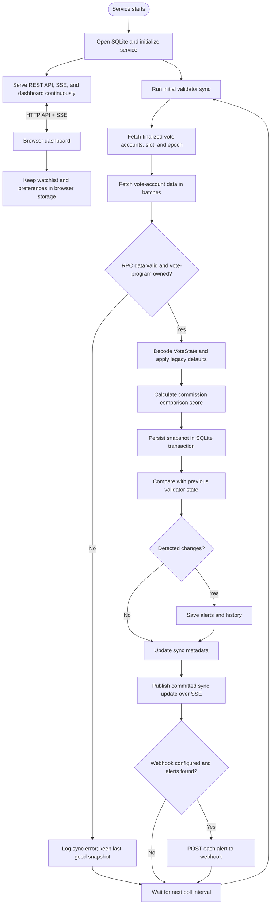

# Staker Watchdog

A small Solana validator data API and dashboard. It polls finalized vote-account state, shows inflation and block-revenue commission separately, tracks their collector accounts, and records changes over time.

## Run locally

Requirements: Node.js 22.9 or newer.

```sh
npm install
cp .env.example .env
npm run dev
```

Open `http://127.0.0.1:3000`. The first sync can take a short while, depending on RPC service latency and mainnet validator count. The SQLite database is created at `.data/staker-watchdog.sqlite`; project data stays in this directory.

For production, build a deployment around `npm start` and inject environment variables through the hosting platform. The server binds to `127.0.0.1` by default; set `HOST=0.0.0.0` when it must accept connections from outside its container or host.

## Database and persistence

The project uses embedded SQLite through `better-sqlite3`; it does not require a database server or a separate account. By default, `DATABASE_PATH=.data/staker-watchdog.sqlite` is resolved against the process working directory, so when started from this project root the live database file is [`.data/staker-watchdog.sqlite`](./.data/staker-watchdog.sqlite). The server creates the parent directory automatically. `.data/` is ignored by Git to keep runtime data out of source control.

The file persists across restarts and contains the latest row for each validator, detected commission/collector/status changes, meaningful validator state history, and sync metadata (last successful sync time, finalized slot, epoch, and count). It is local to this checkout by default; it is not automatically copied to a cloud database. Back it up before deleting the checkout or changing `DATABASE_PATH`. SQLite runs in WAL mode while the service is open, so use SQLite's online backup mechanism (or stop the service first) rather than copying only the main file during writes.

The development smoke test has already populated the default local database. It is disposable runtime state, not a keypair or a required project source file.

## Project documentation

- [Architecture](./docs/ARCHITECTURE.md) — system context, runtime components, sync flow, data model, and trust boundaries.
- [Product overview](./docs/PRODUCT.md) — audience, features, score interpretation, alert semantics, limitations, and product scope.
- [Development log](./docs/DEVLOG.md) — implementation sequence, discovered bugs, decisions, and validation record.
- [Technical reference](./docs/TECHNICAL.md) — stack, RPC protocols, VoteState decoding, API behavior, database schema, runtime configuration, and operational boundaries.
- [Product walkthrough video](./media/staker-watchdog-product-walkthrough.mp4) — silent feature tour.
- [Launch video](./media/staker-watchdog-launch.mp4) — short product introduction.

## What is monitored

- `getVoteAccounts` provides stake, liveness, and the legacy inflation commission view.
- Vote accounts are fetched in batches and their program owner checked before decoding.
- `VoteStateV4` account data provides the full-basis-point inflation and block-revenue commissions, plus separate collector addresses. For legacy vote states, the API uses the [accepted Vote Account v4 migration defaults](https://github.com/solana-foundation/solana-improvement-documents/blob/main/proposals/0185-vote-account-v4.md) (inflation commission from the legacy commission, block-revenue commission 100%, inflation collector = vote account, block-revenue collector = validator identity) and marks them as `legacy_migration_default`. Unknown account versions are not guessed.
- The first successful sync establishes the alert baseline. Subsequent commission, collector, and current/delinquent status changes are stored in SQLite, with a baseline and meaningful state transitions available to validator profiles. An optional `ALERT_WEBHOOK_URL` receives one JSON POST per detected change.
- Failed or empty RPC snapshots do not replace the last good database snapshot. Polling errors and webhook delivery failures are logged.

## Workflow



The `commissionScore` is only a comparison aid: `100 - average(inflation commission %, block-revenue commission %)`, clamped to the protocol's effective 0–100% range. Thus both revenue types count equally. It is **not** an estimate of total validator revenue, uptime, reliability, or overall quality; no public RPC field supplies an investor-specific mix of rewards and block revenue.

## API

API data endpoints return JSON; `/api/events` is a Server-Sent Events stream. Public endpoints are free with a per-IP default limit of 120 requests per 15 minutes.

| Method and path | Purpose |
| --- | --- |
| `GET /api/health` | Sync timestamp, finalized slot/epoch, count, and staleness |
| `GET /api/validators` | List data with `q`, `status=current\|delinquent\|watchlist`, `sort=stake\|commission\|inflation\|blockRevenue\|status`, `direction=asc\|desc`, optional `inflationWeight=0..100` for personalized commission sorting, `limit` (max 1000), `offset`, and repeated `watchlist` addresses (max 100) |
| `GET /api/validators/:votePubkey` | One validator record |
| `GET /api/validators/:votePubkey/history` | Baseline and observed meaningful configuration/status transitions |
| `GET /api/alerts?limit=50&offset=0` | Recent commission, collector, and status changes (limit max 200; optionally filtered by repeated `watchlist` addresses) |
| `GET /api/events` | Server-sent events for successful monitor syncs |

The dashboard adds a validator detail route and profile, commission-history chart, full addresses, sorting, 25-row pagination, and a browser-local watchlist. Watchlist entries, commission-mix slider, alert preferences, and notification cursor are stored in this browser's `localStorage`; they are not sent to the server unless their addresses are included as explicit API filters. Optional desktop notifications require the user's browser permission. The browser score can use a chosen inflation/block-revenue weight; the public `commissionScore` remains the documented 50/50 comparison.

List entries include `votePubkey`, `nodePubkey`, `voteStateVersion`, `commissionSource`, `activeStakeLamports` (decimal string, preserving u64 precision), both commission rates in basis points, both collector addresses, status, and `commissionScore`. A field unavailable from the on-chain state is `null`.

### Institutional API keys

This MVP leaves billing out of the product. Configure provisioned keys using `STAKER_API_KEYS=secret-key:institution,another-key:institution` and send them in `X-API-Key`. Keys are hashed in memory; invalid supplied keys receive `401`. Configured keys get the `PAID_RATE_LIMIT` request allowance per 15-minute window (default 6000), tracked per key. This is a manually provisioned higher-limit tier, not payment processing or a tenant-management system.

## Configuration

See [.env.example](./.env.example). `RPC_URL` should point to a trusted Solana mainnet RPC that allows `getVoteAccounts`, `getMultipleAccounts`, and `getEpochInfo`. Polling defaults to every five minutes. Alert webhooks are optional.

## Validation

```sh
npm test
npm run typecheck
```
