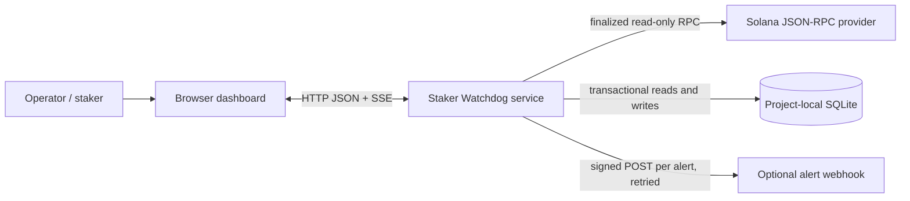
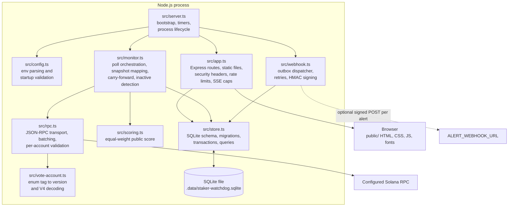
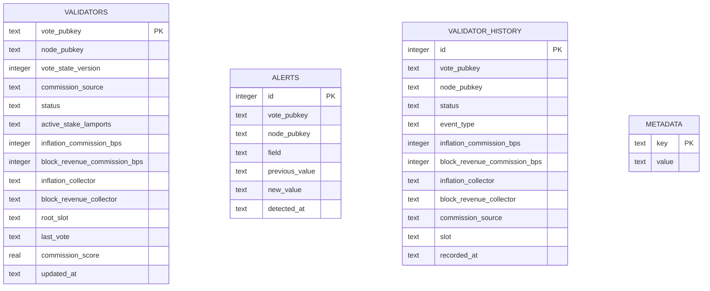

# Staker Watchdog — Architecture

## Scope and design

Staker Watchdog is a read-only Solana data service with a browser dashboard. Its primary job is to periodically observe finalized vote-account state, interpret both commission streams and their collectors, persist the latest snapshot and observed changes, and expose the results through an HTTP API.

The current architecture intentionally favors a small, single-process deployment: the API, poller, and embedded database run together. There is no Solana program, wallet, signer, or transaction submission path.

## System context



The browser communicates only with the watchdog API. The backend is responsible for RPC access and data interpretation; the browser does not connect to Solana directly. Watchlists, display preferences, and the notification cursor remain in the individual browser's `localStorage`, except when a user explicitly sends watchlist addresses as API filters.

## Runtime containers



The process starts the HTTP listener and triggers an initial sync. A timer invokes subsequent syncs at `POLL_INTERVAL_MS` intervals (five minutes by default). A guard prevents overlapping poll operations within the process. The default database path is resolved from the process working directory; when launched at the project root it is `.data/staker-watchdog.sqlite`.

## Poll and change-detection flow

```mermaid
sequenceDiagram
    participant Timer as Startup / poll timer
    participant Monitor as ValidatorMonitor
    participant RPC as SolanaRpc
    participant Chain as Solana JSON-RPC
    participant Decoder as VoteState decoder
    participant Store as WatchdogStore
    participant Clients as API / SSE clients
    participant Dispatcher as WebhookDispatcher
    participant Hook as Optional webhook

    Timer->>Monitor: sync()
    par finalized vote accounts
        Monitor->>RPC: getVoteAccounts()
        RPC->>Chain: getVoteAccounts(finalized)
        Chain-->>RPC: current + delinquent entries
    and finalized slot
        Monitor->>RPC: getSlot()
        RPC->>Chain: getSlot(finalized)
        Chain-->>RPC: slot
    and finalized epoch
        Monitor->>RPC: getEpoch()
        RPC->>Chain: getEpochInfo(finalized)
        Chain-->>RPC: epoch
    end
    Monitor->>RPC: getVoteStateDetails(vote keys)
    loop batches of at most 100 vote accounts
        RPC->>Chain: getMultipleAccounts(base64, finalized)
        Chain-->>RPC: account owner + data
        RPC->>Decoder: validate and decode account state
        Decoder-->>RPC: version, commissions, collectors
    end
    RPC-->>Monitor: decoded details + per-account failures
    Monitor->>Monitor: map state, apply legacy migration defaults,<br/>carry forward unreadable accounts,<br/>find removed validators, calculate score
    Monitor->>Store: applySnapshot(validators, slot, epoch, inactive keys)
    Store->>Store: one SQLite transaction:<br/>compare, write alerts/history,<br/>mark inactive, upsert latest rows and metadata
    Store-->>Monitor: detected alerts
    Monitor-->>Clients: publish committed sync via SSE
    Monitor-)Dispatcher: kick() when alerts were found
    Note over Monitor: sync ends; delivery continues independently
    loop alerts after the delivery cursor, in id order
        Dispatcher->>Store: read next alerts
        Dispatcher->>Hook: signed JSON POST
        Hook-->>Dispatcher: HTTP result
        Dispatcher->>Store: advance cursor (or retry with backoff)
    end
```

The RPC data is treated as untrusted input: response shape and status are checked, non-null vote accounts must be owned by the canonical vote program, account data must be valid base64 metadata, and unsupported or truncated states are rejected rather than guessed. An envelope-level failure fails the whole sync; a failure for one account is logged and that validator keeps its last decoded configuration. RPC u64 values are parsed without JavaScript floating-point loss; activated stake remains a decimal lamport string through storage and the API.

### Successful and failed observations

- The snapshot is assembled before persistence. A failed RPC read, malformed RPC envelope, or empty vote-account result does not overwrite the last good snapshot.
- One unreadable account (missing, wrong owner, unknown enum tag, malformed data) does not fail the sync. The account is logged and its commissions, collectors, source, and version are carried forward from the last decoded state, so a gap can neither erase data nor hide a change made during it.
- Validators no longer returned by `getVoteAccounts` are marked `inactive` with a status alert, keeping their last configuration. If a single sync would remove more than max(10, 20%) of the active validators, removals are skipped as a likely truncated response.
- The store applies each complete snapshot in a SQLite transaction. It compares against the previous latest row, writes alert rows for changed commissions, collectors, and status, writes a baseline or meaningful history transition, upserts the latest validator row, and updates sync metadata.
- The monitor publishes an update only after that transaction commits. SSE is a live notification channel, not a durable event log; clients can recover using the regular API and persisted history.
- Optional webhooks are delivered by a separate dispatcher that treats the `alerts` table as an outbox and stores its cursor in `metadata`. Delivery is ordered, at least once, survives restarts, and never blocks the poll loop. Transient failures retry with capped backoff until they succeed; permanent `4xx` rejections are logged and skipped.
- History represents states observed by polling. Changes that occur and revert between polls are inherently not captured.

## API and browser boundaries

### Backend

Express serves static assets from `public/` and exposes:

| Route | Responsibility |
| --- | --- |
| `GET /api/health` | Last successful sync metadata and staleness |
| `GET /api/validators` | Search, filter, sort, and paginate latest rows |
| `GET /api/validators/:votePubkey` | Current validator detail |
| `GET /api/validators/:votePubkey/history` | Poll-observed history |
| `GET /api/alerts` | Persisted changes, optionally filtered by supplied watchlist |
| `GET /api/events` | SSE connection status and committed sync updates |
| `GET /validator/:votePubkey` | Serves the dashboard shell for bookmarkable profiles |

Most API routes use an in-memory per-IP free-tier limiter (IPv6 grouped per `/64`; client IPs come from `X-Forwarded-For` only when `TRUST_PROXY` names the trusted proxies). Requests with an unrecognised API key are charged to that free bucket, so keys cannot be guessed without limit. Optional provisioned API keys (at least 32 characters) select a higher in-memory per-key limit; this is not billing, tenant management, or durable key storage. Open SSE streams are capped per client and in total. The health endpoint is registered before the `/api` rate-limit middleware.

Every response carries a strict Content-Security-Policy and related security headers, and error responses never include stack traces or file paths.

### Browser

The static browser application fetches API data, renders validator listings and profiles, draws commission history, and listens for server-sent updates. SSE updates drive refreshes; it polls only while the stream is down, and backs off on `429` responses using `Retry-After`. Fonts are served from `public/fonts`, so the page makes no third-party requests. Below 600px the directory renders as labelled cards, and deep links open the profile after the directory has rendered. Browser-only state includes watchlist membership, commission mix, alert-category preferences, commission-increase threshold, and notification cursor. Desktop notifications are opt-in and depend on browser permission.

The server's public score is equally weighted between inflation and block-revenue commissions. The browser can choose a personal mix for display and sorting; that preference does not alter the stored score or on-chain data.

## Persistence model



`validators` is one mutable latest-state row per vote account. `alerts` and `validator_history` are append-only observation records. `metadata` stores the most recent successful sync time, slot, epoch, active validator count, and the webhook delivery cursor. `alerts` doubles as the webhook outbox. `status` is `current`, `delinquent`, or `inactive`. SQLite uses WAL mode; its project-local data is excluded from Git. Backup and retention are operator responsibilities in this MVP.

The `vote_pubkey` values associate alert/history rows with validator rows logically; the current schema does not enforce those associations with SQLite foreign-key constraints.

## Trust boundaries and operational constraints

1. **RPC provider → service:** RPC can be unavailable, rate-limited, malformed, or return unexpected account data. Envelope validation and all-or-nothing snapshot assembly protect the last good stored snapshot; individual bad accounts are isolated and carried forward; a suspiciously small validator list cannot mass-mark validators inactive. Errors are logged.
2. **Service → browser/API consumer:** API input is parsed and bounded where relevant; public requests and invalid-key attempts are rate-limited; SSE streams are capped; responses carry CSP and related headers; errors expose no internals. API keys are optional and provisioned through environment configuration. Behind a proxy, `TRUST_PROXY` must name it or every client shares one rate-limit bucket.
3. **Service → webhook destination:** The configured destination receives validator change data. Set `ALERT_WEBHOOK_SECRET` so receivers can verify the HMAC signature and timestamp, deduplicate on the delivery ID, and protect the URL and secret as deployment configuration.
4. **Browser storage:** Watchlists and preferences are local to that browser profile, not synced user accounts. Clearing browser storage clears this state.
5. **Single-process state:** Poll scheduling, SSE client connections, and request counters are process-local. Multiple instances would poll independently and would not share SSE clients or rate-limit counters. A production multi-instance deployment should externalize scheduling/coordination, rate limiting, and live event fan-out before scaling horizontally.

## Deliberate non-components

- **No Solana program:** The product observes existing public on-chain state; it does not need program-owned state or instructions.
- **No keypair or wallet:** There are no signed transactions or account-authority operations.
- **No separate database server or queue:** SQLite is embedded, and the `alerts` table plus a metadata cursor serve as the durable webhook outbox. Higher-volume or multi-instance deployments may later introduce managed relational storage and a dedicated queue.
- **No authoritative validator-name registry:** The current system keys records by on-chain public keys; trusted name/attribution metadata requires a separately sourced and maintained registry.

For the exact RPC fields, decoder offsets, API query parameters, and configuration reference, see [TECHNICAL.md](./TECHNICAL.md). For webhooks and the other integration points (SSE, desktop notifications, JSON API, RPC), see [INTEGRATIONS.md](./INTEGRATIONS.md).
