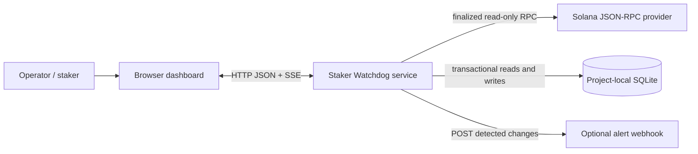
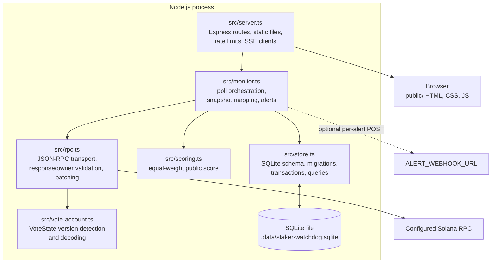
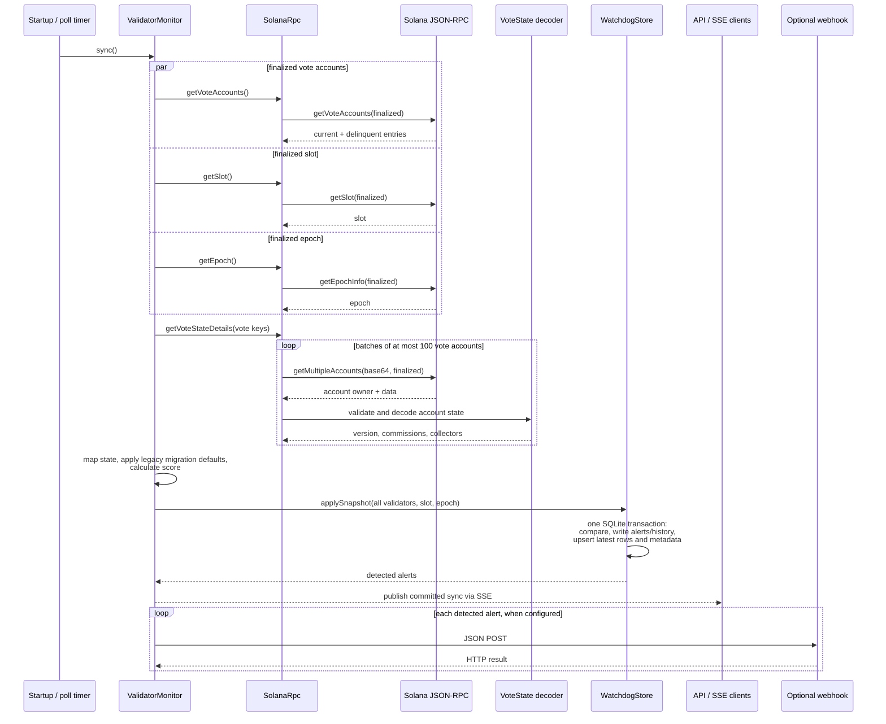
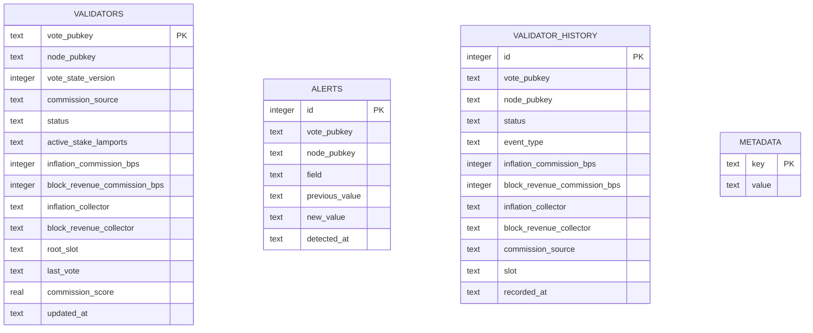

# Staker Watchdog — Architecture

## Scope and design

Staker Watchdog is a read-only Solana data service with a browser dashboard. Its primary job is to periodically observe finalized vote-account state, interpret both commission streams and their collectors, persist the latest snapshot and observed changes, and expose the results through an HTTP API.

The current architecture intentionally favors a small, single-process deployment: the API, poller, and embedded database run together. There is no Solana program, wallet, signer, or transaction submission path.

## System context

The browser communicates only with the watchdog API. The backend is responsible for RPC access and data interpretation; the browser does not connect to Solana directly. Watchlists, display preferences, and the notification cursor remain in the individual browser's `localStorage`, except when a user explicitly sends watchlist addresses as API filters.

## Runtime containers

The process starts the HTTP listener and triggers an initial sync. A timer invokes subsequent syncs at `POLL_INTERVAL_MS` intervals (five minutes by default). A guard prevents overlapping poll operations within the process. The default database path is resolved from the process working directory; when launched at the project root it is `.data/staker-watchdog.sqlite`.

## Poll and change-detection flow

The RPC data is treated as untrusted input: response shape and status are checked, non-null vote accounts must be owned by the canonical vote program, account data must be valid base64 metadata, and unsupported or truncated state versions fail the sync rather than being guessed. RPC u64 values are parsed without JavaScript floating-point loss; activated stake remains a decimal lamport string through storage and the API.

### Successful and failed observations

- The snapshot is assembled before persistence. A failed RPC read, invalid account, unsupported state, or empty vote-account result does not overwrite the last good snapshot.
- The store applies each complete snapshot in a SQLite transaction. It compares against the previous latest row, writes alert rows for changed commissions, collectors, and current/delinquent status, writes a baseline or meaningful history transition, upserts the latest validator row, and updates sync metadata.
- The monitor publishes an update only after that transaction commits. SSE is a live notification channel, not a durable event log; clients can recover using the regular API and persisted history.
- Optional webhook requests are sent after the database commit. A webhook delivery failure is logged but does not roll back stored state or prevent later alerts from being attempted.
- History represents states observed by polling. Changes that occur and revert between polls are inherently not captured.

## API and browser boundaries

### Backend

Express serves static assets from `public/` and exposes:

| Route | Responsibility |
| --- | --- |
| `GET /api/health` | Last successful sync metadata and staleness |
| `GET /api/validators` | Search, filter, sort, and paginate latest rows |
| `GET /api/validators/:votePubkey` | Current validator detail |
| `GET /api/validators/:votePubkey/history` | Poll-observed history |
| `GET /api/alerts` | Persisted changes, optionally filtered by supplied watchlist |
| `GET /api/events` | SSE connection status and committed sync updates |
| `GET /validator/:votePubkey` | Serves the dashboard shell for bookmarkable profiles |

Most API routes use an in-memory per-IP free-tier limiter. Optional provisioned API keys select a higher in-memory per-key limit; this is not billing, tenant management, or durable key storage. The health endpoint is registered before the `/api` rate-limit middleware.

### Browser

The static browser application fetches API data, renders validator listings and profiles, draws commission history, and listens for server-sent updates. It also refreshes periodically as a fallback to SSE. Browser-only state includes watchlist membership, commission mix, alert-category preferences, commission-increase threshold, and notification cursor. Desktop notifications are opt-in and depend on browser permission.

The server's public score is equally weighted between inflation and block-revenue commissions. The browser can choose a personal mix for display and sorting; that preference does not alter the stored score or on-chain data.

## Persistence model

`validators` is one mutable latest-state row per vote account. `alerts` and `validator_history` are append-only observation records. `metadata` stores the most recent successful sync time, slot, epoch, and count. SQLite uses WAL mode; its project-local data is excluded from Git. Backup and retention are operator responsibilities in this MVP.

The `vote_pubkey` values associate alert/history rows with validator rows logically; the current schema does not enforce those associations with SQLite foreign-key constraints.

## Trust boundaries and operational constraints

1. **RPC provider → service:** RPC can be unavailable, rate-limited, malformed, or return unexpected account data. Validation and all-or-nothing snapshot assembly protect the last good stored snapshot; errors are logged.
2. **Service → browser/API consumer:** API input is parsed and bounded where relevant; public requests are rate-limited. API keys are optional and provisioned through environment configuration.
3. **Service → webhook destination:** The configured destination receives validator change data. Use a trusted endpoint and protect the URL as deployment configuration.
4. **Browser storage:** Watchlists and preferences are local to that browser profile, not synced user accounts. Clearing browser storage clears this state.
5. **Single-process state:** Poll scheduling, SSE client connections, and request counters are process-local. Multiple instances would poll independently and would not share SSE clients or rate-limit counters. A production multi-instance deployment should externalize scheduling/coordination, rate limiting, and live event fan-out before scaling horizontally.

## Deliberate non-components

- **No Solana program:** The product observes existing public on-chain state; it does not need program-owned state or instructions.
- **No keypair or wallet:** There are no signed transactions or account-authority operations.
- **No separate database server or queue:** SQLite is embedded and webhooks are sent directly after commit. Higher-volume deployments may later introduce managed relational storage and durable asynchronous delivery.
- **No authoritative validator-name registry:** The current system keys records by on-chain public keys; trusted name/attribution metadata requires a separately sourced and maintained registry.

For the exact RPC fields, decoder offsets, API query parameters, and configuration reference, see [TECHNICAL.md](./TECHNICAL.md).
