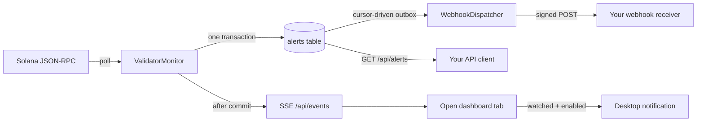
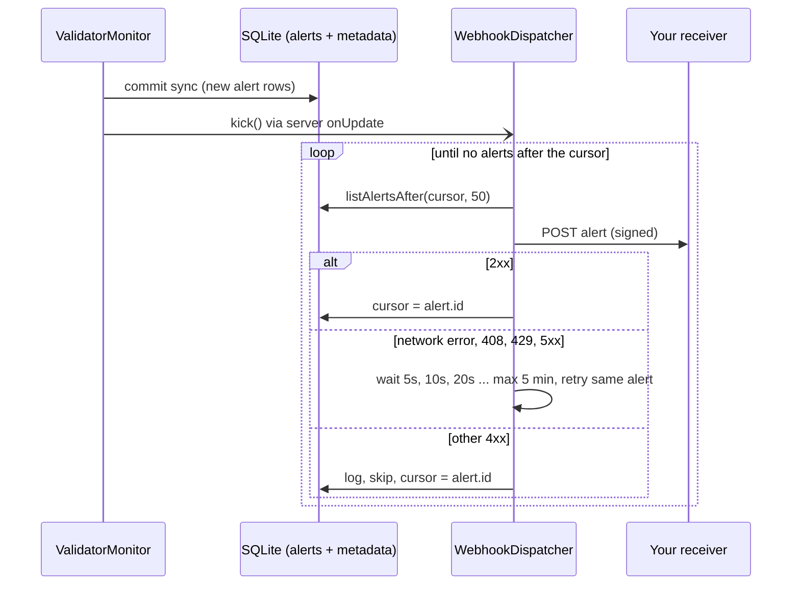

# Staker Watchdog — Webhooks and other integration points

This document explains how Staker Watchdog talks to other systems: what a webhook is, how and where this project uses one, and the related mechanisms that move the same change data around (live browser events, desktop notifications, the JSON API, and the Solana RPC it reads from).

## At a glance

| Mechanism | Direction | Transport | Who starts it | Durable? | Main code |
| --- | --- | --- | --- | --- | --- |
| [Alert webhook](#1-alert-webhook) | Service → your server | HTTP `POST`, one per alert | The service, after a sync finds changes | Yes: retried until delivered, survives restarts | [`src/webhook.ts`](../src/webhook.ts) |
| [Server-Sent Events](#2-server-sent-events-live-dashboard-updates) | Service → open browser tab | `text/event-stream` (`GET /api/events`) | The browser opens it; the service pushes after each sync | No: live only | [`src/app.ts`](../src/app.ts), [`public/app.js`](../public/app.js) |
| [Desktop notifications](#3-browser-desktop-notifications) | Browser → the user's desktop | Web Notification API | The open dashboard, on an SSE event | No: needs an open tab | [`public/app.js`](../public/app.js) |
| [JSON API + API keys](#4-json-api-and-api-keys) | Your client → service | HTTP `GET` | Your client, whenever it polls | Data is durable in SQLite | [`src/app.ts`](../src/app.ts), [`src/config.ts`](../src/config.ts) |
| [Solana JSON-RPC](#5-solana-json-rpc-outbound-reads) | Service → RPC provider | HTTP `POST` (JSON-RPC 2.0) | The poller, every `POLL_INTERVAL_MS` | n/a (source of truth is the chain) | [`src/rpc.ts`](../src/rpc.ts) |

All of these carry the same underlying record: an **alert**. An alert is a row in the SQLite `alerts` table, written when a sync detects that a validator's inflation commission, block-revenue commission, either collector account, or status (`current` / `delinquent` / `inactive`) changed. A row is only written after the first sync has established a baseline.



## 1. Alert webhook

### What a webhook is

A webhook is an HTTP request that one system sends to another when something happens. With polling, the receiver keeps asking whether anything changed. With a webhook, the sender calls a URL you own as soon as it has news. The receiver is an ordinary HTTP endpoint that accepts a `POST`, checks it came from the expected sender, does its work (forward to Slack or PagerDuty, update an internal database, open a ticket), and answers with a `2xx` status.

### What this project uses it for

The webhook is the **server-to-server alert channel**. Every time a sync records an alert, the service sends that alert as JSON to `ALERT_WEBHOOK_URL`. This is how an operator, staking pool, or custodian is told about validator changes without keeping a dashboard open or polling the API. It is optional: with no URL configured, no dispatcher is created and nothing is sent.

### Where it is used in the code

| Location | Role |
| --- | --- |
| [`src/config.ts`](../src/config.ts) (`loadConfig`) | Reads `ALERT_WEBHOOK_URL` (must be `http(s)`, otherwise startup fails) and `ALERT_WEBHOOK_SECRET`. |
| [`src/server.ts`](../src/server.ts) | Creates the `WebhookDispatcher` only when a URL is set, warns if there is no secret, calls `kick()` from the monitor's `onUpdate` callback when a sync produced alerts, calls `kick()` once at startup to deliver anything left over, and `stop()` on shutdown. |
| [`src/webhook.ts`](../src/webhook.ts) (`WebhookDispatcher`) | Delivery loop: reads undelivered alerts, signs and `POST`s each one, retries, and advances the cursor. `signWebhookPayload` implements the signature. |
| [`src/store.ts`](../src/store.ts) | `listAlertsAfter`, `getLatestAlertId`, `getMetadata`, and `setMetadata` back the outbox and its cursor (`webhook_delivered_alert_id` in the `metadata` table). |
| [`src/monitor.ts`](../src/monitor.ts) | Produces the alerts. It does **not** send webhooks itself, so a slow receiver can never delay a sync. |
| [`test/webhook.test.ts`](../test/webhook.test.ts) | Ordering, signature, no history replay, retry/skip rules, and resuming from the cursor after a restart. |

### How delivery works

The `alerts` table is used as an **outbox**: alerts are durable the moment the sync transaction commits, and a separate dispatcher drains them in order.



| Property | Behaviour |
| --- | --- |
| Ordering | Strictly by alert ID. Alert *n + 1* is not sent until alert *n* is delivered or permanently rejected. |
| Guarantee | At least once. A crash between a successful `POST` and saving the cursor resends that alert, so deduplicate on the delivery ID. |
| First start | The cursor starts at the newest existing alert, so enabling a webhook does not replay history. |
| Restarts | Delivery resumes from the stored cursor, including alerts created while the process was down. |
| Transient failures | Network errors, timeouts (10 s per attempt), `408`, `429`, `5xx`: retried indefinitely with exponential backoff from 5 s up to 5 min. An outage delays alerts but does not lose them. |
| Permanent failures | Any other `4xx` (for example `400`, `401`, `404`): logged as `Webhook rejected alert … not retrying`, then skipped. |
| Redirects | Not followed (`redirect: "error"`); a `3xx` is treated as a transient failure. Use the final URL. |
| Shutdown | `SIGINT`/`SIGTERM` stops the dispatcher immediately; an undelivered alert stays undelivered and is sent on the next start. |

### Request format

`POST` to `ALERT_WEBHOOK_URL` with `Content-Type: application/json`. The body is exactly one alert:

```json
{
  "id": 42,
  "votePubkey": "HxRrsnbc6K8CdEo3LCTrSUkFaDDxv9BdJsTDzBKnUVWH",
  "nodePubkey": "7y5VhV4fkz6r4zUmH2UiwPjLwXzPL1PcV28or5NWkWRL",
  "field": "block_revenue_collector",
  "previousValue": "7y5VhV4fkz6r4zUmH2UiwPjLwXzPL1PcV28or5NWkWRL",
  "newValue": "HxRrsnbc6K8CdEo3LCTrSUkFaDDxv9BdJsTDzBKnUVWH",
  "detectedAt": "2026-10-18T06:23:06.890Z"
}
```

`field` is one of `inflation_commission`, `block_revenue_commission` (values in basis points, as strings), `inflation_collector`, `block_revenue_collector` (Base58 addresses), or `validator_status` (`current`, `delinquent`, `inactive`).

| Header | Value |
| --- | --- |
| `X-Staker-Watchdog-Delivery` | The alert ID. Use it as an idempotency key. |
| `X-Staker-Watchdog-Timestamp` | Unix seconds when this attempt was signed. Each retry is signed again with a new timestamp. |
| `X-Staker-Watchdog-Signature` | `v1=` followed by the hex HMAC-SHA256 of `"<timestamp>.<raw body>"`, keyed with `ALERT_WEBHOOK_SECRET`. Sent only when the secret is set. |

### Writing a receiver

A receiver should (1) verify the signature over the **raw** body before parsing it, using a constant-time comparison, (2) reject stale timestamps, (3) ignore delivery IDs it has already processed, and (4) answer `2xx` quickly, within the 10-second timeout, doing slow work afterwards. A minimal Node.js receiver:

```js
import { createHmac, timingSafeEqual } from "node:crypto";
import http from "node:http";

const secret = process.env.ALERT_WEBHOOK_SECRET;
const seen = new Set(); // use durable storage in production

function handleAlert(alert) {
  console.log(`${alert.votePubkey} ${alert.field}: ${alert.previousValue} -> ${alert.newValue}`);
}

http.createServer((request, response) => {
  let body = "";
  request.on("data", (chunk) => { body += chunk; });
  request.on("end", () => {
    const timestamp = String(request.headers["x-staker-watchdog-timestamp"] ?? "");
    const signature = String(request.headers["x-staker-watchdog-signature"] ?? "");
    const expected = `v1=${createHmac("sha256", secret).update(`${timestamp}.${body}`).digest("hex")}`;
    const valid = signature.length === expected.length &&
      timingSafeEqual(Buffer.from(signature), Buffer.from(expected));
    const fresh = Math.abs(Date.now() / 1000 - Number(timestamp)) <= 300;
    if (!valid || !fresh) {
      response.writeHead(401).end();
      return;
    }
    const deliveryId = String(request.headers["x-staker-watchdog-delivery"]);
    if (!seen.has(deliveryId)) {
      seen.add(deliveryId);
      handleAlert(JSON.parse(body));
    }
    response.writeHead(204).end();
  });
}).listen(8900, "127.0.0.1");
```

This example was run against the real dispatcher: a correctly signed alert is handled once even when delivered twice, and a wrong secret receives `401`.

> **A `401` is a permanent rejection, so the dispatcher skips that alert.** If the receiver's secret is wrong, every alert is logged and dropped from the webhook channel (the alerts stay in SQLite and `/api/alerts`). While rotating secrets, have the receiver accept both the old and new secret, or answer `503` so deliveries are retried until the secrets match.

### Configuring and trying it locally

```sh
# .env
ALERT_WEBHOOK_URL=http://127.0.0.1:8900/
ALERT_WEBHOOK_SECRET=$(openssl rand -hex 32)
```

Start the receiver above with the same `ALERT_WEBHOOK_SECRET`, then `npm run dev`. The first sync only establishes the baseline; alerts, and therefore webhooks, appear when a later sync sees a change. Server logs show `Retrying webhook for alert …` or `Webhook rejected alert …` when deliveries fail.

To redeliver past alerts deliberately, stop the service and lower the cursor, for example `UPDATE metadata SET value = '0' WHERE key = 'webhook_delivered_alert_id';`. Every alert after that ID is sent again, in order, on the next start.

### Limitations

- One destination URL. For several consumers, point it at a fan-out service of your own.
- Head-of-line blocking: while one alert is being retried, later alerts wait. This is the cost of strict ordering.
- The URL and secret live in process environment configuration; treat both as credentials.
- There is no per-validator filtering on the server side. Filter in the receiver using `votePubkey` and `field`.

## 2. Server-Sent Events (live dashboard updates)

**What it is.** Server-Sent Events (SSE) is a one-way HTTP stream from server to browser. The browser's built-in `EventSource` keeps a `GET` request open and the server writes events to it. It needs no WebSocket server and reconnects automatically.

**What we use it for.** Keeping open dashboards current without polling. After each successful sync commits, the service pushes one `update` event, and the page reloads its data through the normal JSON API.

**Where:**

- [`src/app.ts`](../src/app.ts): the `GET /api/events` route sends a `connected` event, then `update` events from `publishUpdate`. It also sends a `: keep-alive` comment every 25 seconds, closes clients whose write buffer is full, and enforces `SSE_MAX_CONNECTIONS_PER_CLIENT` (default 10, answered with `429`) and `SSE_MAX_CONNECTIONS` (default 1000, answered with `503` and `Retry-After: 60`).
- [`src/server.ts`](../src/server.ts): the monitor's `onUpdate` callback calls `publishUpdate` after every committed sync.
- [`public/app.js`](../public/app.js) (`connectLiveUpdates`): opens the stream and refreshes on each `update` (and once after a reconnect). It polls every 2 minutes only while the stream is down; if the server refuses the stream, it switches to that periodic mode and tries again after 5 minutes.

**Event payload** (`event: update`): `{ slot, epoch, validatorCount, syncedAt, alerts: [...] }`, where `alerts` holds the same alert objects the webhook sends.

**How it differs from the webhook.** SSE is live only: a tab that is closed or disconnected misses events and catches up through the API, with no retry or replay. Use SSE for screens people are watching, and the webhook for systems that must not miss a change. Opening a stream counts as one request against the API rate limit; open streams are capped separately.

## 3. Browser desktop notifications

**What it is.** The Web Notification API lets a page show an operating-system notification after the user grants permission.

**What we use it for.** Telling someone who has the dashboard open in a background tab that a validator they watch changed.

**Where:** [`public/app.js`](../public/app.js). Permission is requested only when the user clicks **Enable desktop notifications** (`Notification.requestPermission`). `processLiveAlerts` runs on each SSE `update`. It shows a notification only when all of the following hold:

- the validator is on this browser's watchlist;
- the alert's category (commission, collector, or status) is switched on;
- for commission alerts, the commission rose by at least the user's threshold (default 100 bps). Decreases never notify.

A cursor in `localStorage` (`stakerWatchdog.lastAlertId.v1`) prevents old alerts from popping up again after a reload.

**Limits.** These notifications need an open tab. There is no push service, email, or mobile delivery. For unattended alerting, use the webhook.

## 4. JSON API and API keys

**What it is.** The read-only HTTP API (`/api/health`, `/api/validators`, `/api/validators/:votePubkey`, `/api/validators/:votePubkey/history`, `/api/alerts`) that the dashboard itself uses, available to any client.

**What we use it for.** Pull-style integrations: wallets, dashboards, and scripts that fetch validator data or poll `GET /api/alerts` for changes on their own schedule. `id` in `/api/alerts` increases monotonically, so a client can remember the highest ID it has seen.

**Where:** routes, rate limiting, and headers are in [`src/app.ts`](../src/app.ts). `STAKER_API_KEYS` parsing is in [`src/config.ts`](../src/config.ts). Keys are sent in `X-API-Key`, must be at least 32 characters, and raise the limit from `FREE_RATE_LIMIT` per IP to `PAID_RATE_LIMIT` per key per 15 minutes. A request with an unrecognised key is charged to the caller's free limit and answered with `401`. Full parameters are in [TECHNICAL.md → HTTP API](./TECHNICAL.md#http-api).

**When to use it instead of the webhook.** When you cannot expose an HTTPS endpoint, or you want to backfill or reconcile. A robust integration often uses both: the webhook for immediacy, and a periodic `/api/alerts` check as a safety net.

## 5. Solana JSON-RPC (outbound reads)

**What it is.** The service's only upstream dependency: JSON-RPC 2.0 `POST`s to `RPC_URL` using `getVoteAccounts`, `getMultipleAccounts` (in batches of 100), `getSlot`, and `getEpochInfo`, all at `finalized` commitment.

**Where:** [`src/rpc.ts`](../src/rpc.ts). It requires HTTP success, a JSON-RPC result, the expected response shape, and vote-program ownership. It parses u64 values without precision loss and applies a 30-second timeout per request. [`src/monitor.ts`](../src/monitor.ts) schedules the calls.

**Integration notes.** It is read-only: the service never signs or submits a transaction. Use a trusted RPC provider that allows `getMultipleAccounts`, because a malicious RPC could report false on-chain state. If the provider fails or returns a malformed response, the sync fails and the last good snapshot is kept. A single unreadable account is logged and keeps its last known values. Details are in [TECHNICAL.md → Solana protocols](./TECHNICAL.md#solana-protocols-and-state-interpretation).

## Choosing a mechanism

| Need | Use |
| --- | --- |
| A backend system must react to every change, even after downtime | Webhook (plus a periodic `/api/alerts` check if you need belt and braces) |
| People watching a screen should see changes immediately | SSE (built into the dashboard) |
| One person wants a pop-up for validators they watch while the tab is open | Desktop notifications |
| Read validator data or alerts on your own schedule, or backfill | JSON API, with an API key for higher limits |
| Change where the data comes from | `RPC_URL` |
